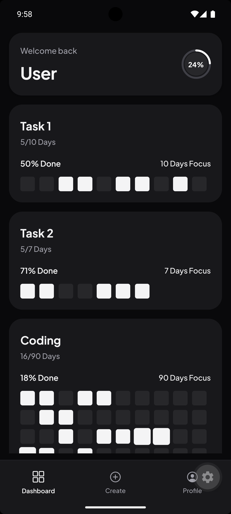
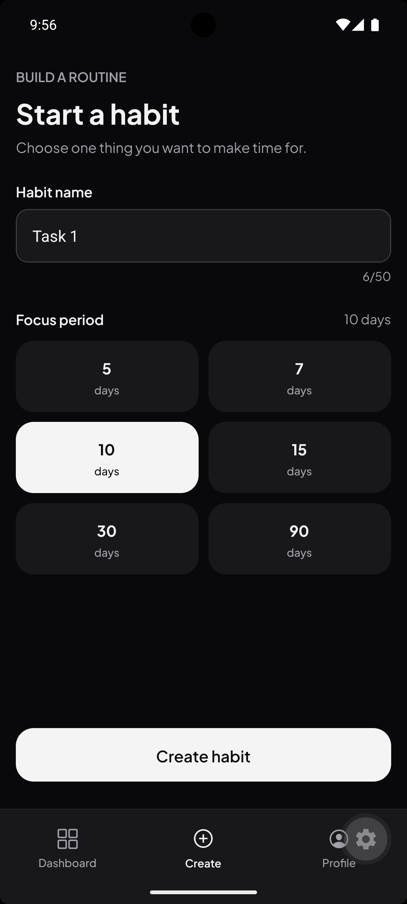
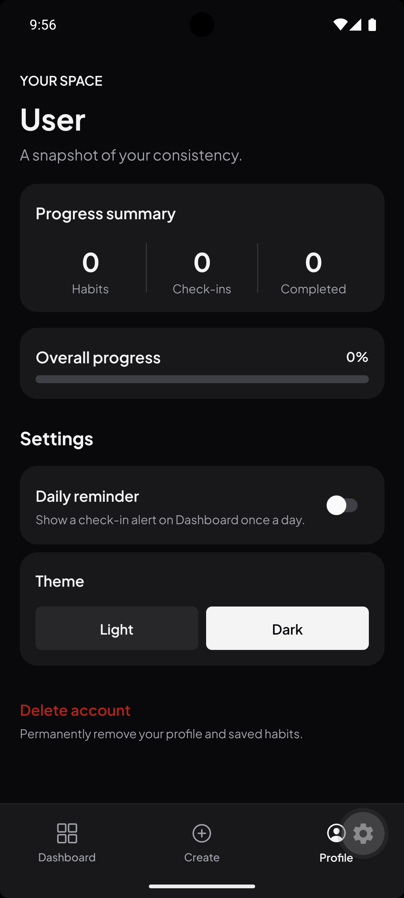

# HabiTrack

<p align="center">
  
</p>

A minimalist, privacy-first habit tracking application built with React Native and Expo. Designed with a monochrome aesthetic, fluid micro-interactions, and offline-first persistence.

---

## Download APK

Direct download for Android devices:

- **[Download Latest APK](https://expo.dev/accounts/rvndu/projects/habitrack/builds/281f586e-dfbd-4cf5-a184-03762d12eef7)**

> **Installation Note**: When installing outside the Google Play Store, Android will request permission to install unknown apps. Tap **Settings** and enable **Allow from this source** to proceed.

---

## Overview

HabiTrack focuses on clarity and consistency. Instead of overwhelming charts and complex gamification, it provides a clean visual matrix of your progress across custom focus periods (7, 14, 21, 30, 60, or 90 days). All data is stored locally on the device with zero cloud dependencies or account requirements.

---

## App Screenshots

| Dashboard | Create a Habit | Profile |
|:---:|:---:|:---:|
|  |  |  |

---

## Key Features

- **Daily Grid Matrix**: Interactive day blocks with spring animations powered by React Native Reanimated. Tap any day to toggle progress.
- **Progress Ring Indicator**: Dual-ring SVG badge calculating real-time completion rates across all active routines.
- **Sticky Floating Header**: Floating welcome header with elevation shadows that stays pinned at the top while habit cards scroll beneath.
- **Custom Focus Periods**: Support for 7, 14, 21, 30, 60, and 90-day habit cycles.
- **Swipe-to-Delete**: Native swipe gesture on habit cards with a custom confirmation modal to prevent accidental data loss.
- **Monochrome Design System**: High-contrast, accessibility-tested black-and-white theme with dedicated light and dark modes.
- **Offline & Private**: Built on Zustand with AsyncStorage persistence. No remote databases, telemetry, or user tracking.
- **Android Optimized**: Tuned hardware elevations, seamless black splash screen transitions, and full edge-to-edge system navigation support.

---

## Tech Stack

| Layer              | Technology                                                                                                                                                   |
| ------------------ | ------------------------------------------------------------------------------------------------------------------------------------------------------------ |
| Framework          | [React Native 0.86](https://reactnative.dev/) / [Expo SDK 57](https://expo.dev/)                                                                             |
| Routing            | [Expo Router](https://docs.expo.dev/router/introduction/) (file-based navigation)                                                                            |
| Language           | [TypeScript](https://www.typescriptlang.org/) (strict mode)                                                                                                  |
| State Management   | [Zustand](https://github.com/pmndrs/zustand) with `persist` middleware                                                                                       |
| Local Storage      | [@react-native-async-storage/async-storage](https://github.com/react-native-async-storage/async-storage)                                                     |
| Animations         | [React Native Reanimated](https://docs.swmansion.com/react-native-reanimated/) & [Gesture Handler](https://docs.swmansion.com/react-native-gesture-handler/) |
| Vectors & Graphics | [React Native SVG](https://github.com/software-mansion/react-native-svg) & [@expo/vector-icons](https://icons.expo.fyi/)                                     |
| Typography         | [Plus Jakarta Sans](https://fonts.google.com/specimen/Plus+Jakarta+Sans) via `@expo-google-fonts`                                                            |

---

## Project Structure

```text
habit-tracker/
├── assets/
│   └── images/              # Icons, logo, splash assets, and branding
├── src/
│   ├── app/                 # Expo Router screens and layouts
│   │   ├── (tabs)/          # Main tab navigation
│   │   │   ├── _layout.tsx  # Custom tab bar with safe-area insets
│   │   │   ├── index.tsx    # Dashboard screen (habit list & header)
│   │   │   ├── create.tsx   # Habit creation form
│   │   │   └── profile.tsx  # User stats and theme configuration
│   │   ├── _layout.tsx      # Root layout, font loader & splash control
│   │   └── onboarding.tsx   # First-launch name setup & animated intro
│   ├── components/          # Domain-specific components
│   │   ├── ui/              # Primitive reusable UI elements (Button, Input, AppText)
│   │   ├── DayGrid.tsx      # Multi-day habit completion matrix
│   │   ├── EmptyState.tsx   # Dashboard fallback when no habits exist
│   │   ├── HabitCard.tsx    # Swipeable habit card component
│   │   └── ProgressRing.tsx # SVG circular completion ring
│   ├── constants/
│   │   └── theme.ts         # Palette definitions, typography, and layout tokens
│   ├── hooks/
│   │   └── useAppColors.ts  # Theme resolver hook for light/dark modes
│   ├── store/
│   │   └── useHabitStore.ts # Central Zustand store with AsyncStorage persistence
│   ├── types/
│   │   └── habit.ts         # TypeScript models for habits, days, and durations
│   └── utils/
│       └── progress.ts      # Pure calculation functions for habit percentages
├── app.json                 # Expo application manifest
├── eas.json                 # EAS build profiles (APK / production)
└── tsconfig.json            # TypeScript configuration
```

---

## Getting Started

### Prerequisites

- Node.js (version 18 or later)
- npm or bun
- [Expo Go](https://expo.dev/go) app installed on your Android device (for local development)

### Installation

1. Clone the repository:

   ```bash
   git clone https://github.com/your-username/habit-tracker.git
   cd habit-tracker
   ```

2. Install dependencies:

   ```bash
   npm install
   ```

3. Start the development server:

   ```bash
   npx expo start
   ```

4. Run the app:
   - **Android Device**: Open Expo Go and scan the QR code printed in the terminal.
   - **Android Emulator**: Press `a` in the terminal to launch on a running emulator.
   - **Web Preview**: Press `w` to open in your browser.

---

## Building the Standalone APK

The project is pre-configured with [EAS Build](https://docs.expo.dev/build/introduction/) to compile standalone `.apk` files without needing Android Studio or local toolchains installed.

1. Install EAS CLI globally or use via `npx`:

   ```bash
   npx eas-cli login
   ```

2. Trigger the preview build:

   ```bash
   npx eas-cli build -p android --profile preview
   ```

3. When prompted to generate an Android Keystore, select **Yes**.

4. Once the cloud compilation completes, EAS provides a direct download URL and QR code in the terminal to download and install the `.apk` on any Android device.

---

## Architecture & State Management

Application state is managed through a single Zustand store with automatic hydration handling:

- **Storage Hydration**: The app displays the splash screen until both the custom Google Fonts and the persisted state from `AsyncStorage` are loaded.
- **Route Guarding**: If no username is set in the store, the root layout automatically redirects the user to `/onboarding`. Once configured, the user is transitioned to `/(tabs)`.
- **Atomic Progress Updates**: Toggling individual days computes progress in pure utility functions (`progress.ts`), isolating business logic from UI components.

---

## Code Quality

Run static type checking across the entire codebase:

```bash
npx tsc --noEmit
```

---

## License

This project is licensed under the MIT License - see the [LICENSE](LICENSE) file for details.
